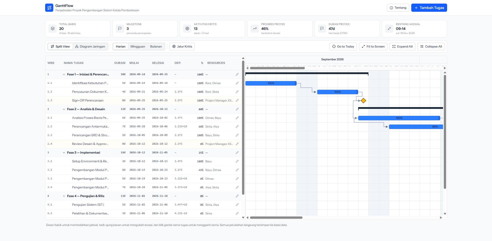
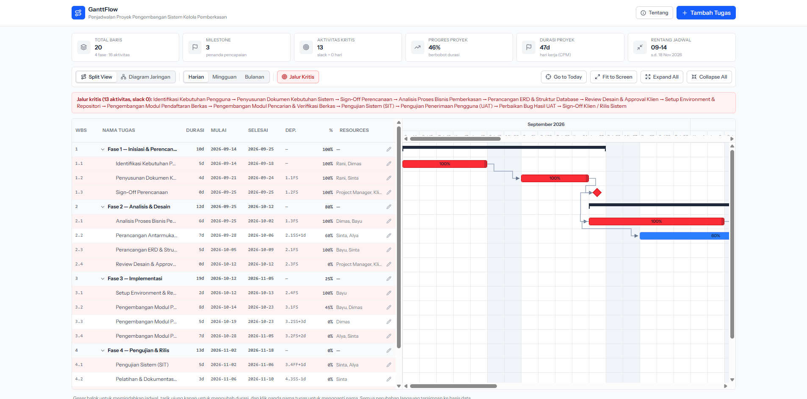
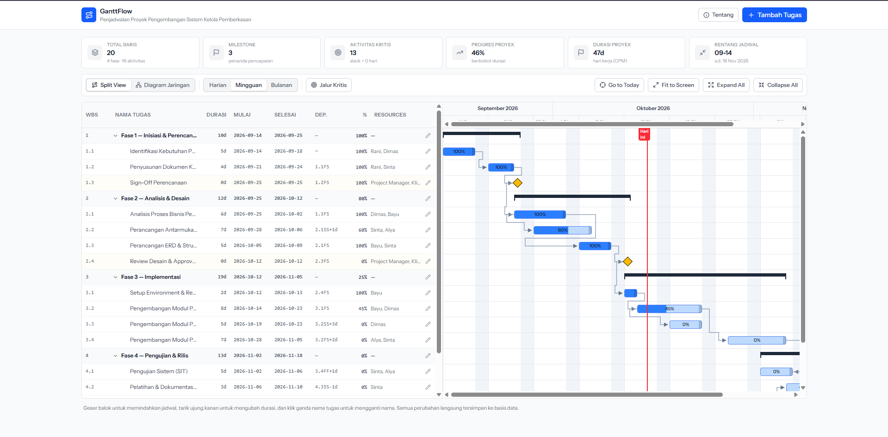
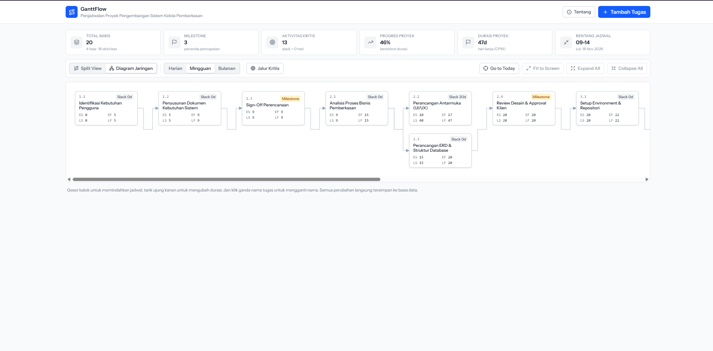
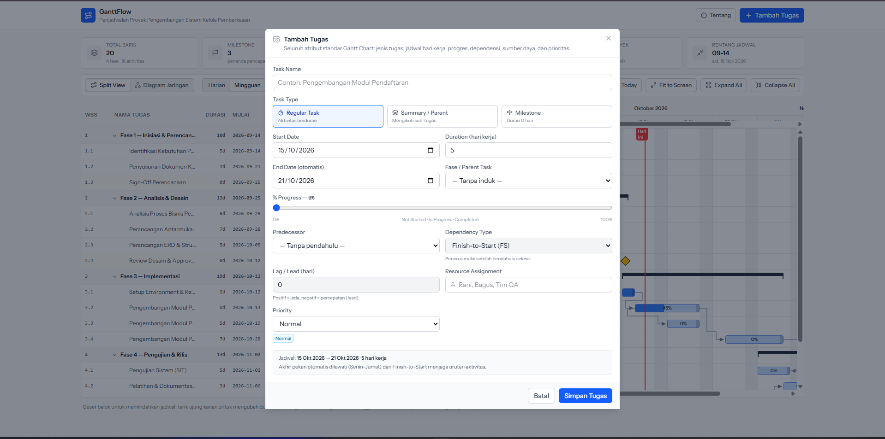
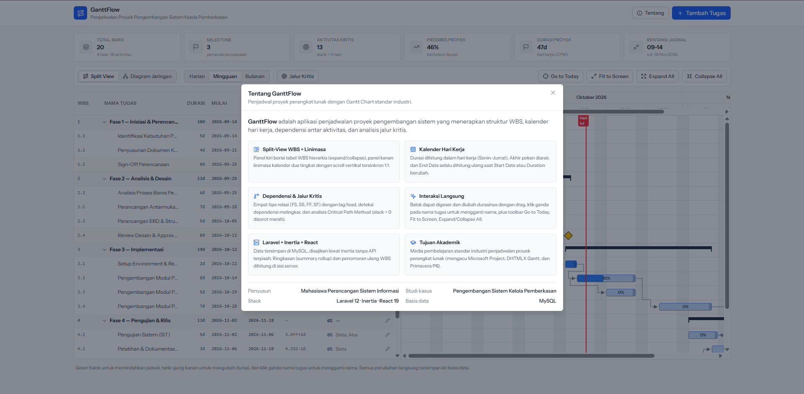

# GanttFlow

> **GanttFlow — Laravel + React + MySQL Project Scheduler**

Aplikasi web **Manajemen Proyek berbasis Gantt Chart** yang dibangun dengan
Laravel, React, Inertia.js, Tailwind CSS, dan MySQL. Aplikasi ini merupakan
implementasi materi **Bab 4 — Perancangan Sistem Informasi**, khususnya tahapan
perencanaan/manajemen proyek: mendefinisikan aktivitas, mengurutkan aktivitas,
mengestimasi lama aktivitas, menyusun jadwal, membuat diagram jaringan, hingga
pengujian sistem.

---

## Daftar Isi

1. [Deskripsi Sistem](#1-deskripsi-sistem)
2. [Fitur Utama](#2-fitur-utama)
3. [Tangkapan Layar (Screenshot)](#3-tangkapan-layar-screenshot)
4. [Teknologi yang Digunakan](#4-teknologi-yang-digunakan)
5. [Prasyarat](#5-prasyarat)
6. [Membuat Database di MySQL](#6-membuat-database-di-mysql)
7. [Konfigurasi `.env`](#7-konfigurasi-env)
8. [Instalasi & Migrasi](#8-instalasi--migrasi)
9. [Struktur Tabel `tasks`](#9-struktur-tabel-tasks)
10. [Perhitungan Critical Path (CPM/PERT)](#10-perhitungan-critical-path-cpmpert)
11. [Data Awal (Seeder)](#11-data-awal-seeder)
12. [Struktur Proyek](#12-struktur-proyek)
13. [Pengujian](#13-pengujian)

---

## 1. Deskripsi Sistem

**GanttFlow** adalah sistem informasi manajemen proyek yang memvisualisasikan
rencana kerja sebagai **Gantt Chart _split-view_** interaktif: panel kiri
berisi **tabel WBS** hierarkis (indentasi, expand/collapse) dan panel kanan
berisi **linimasa kalender dua tingkat** (baris Bulan/Tahun di atas, baris
Hari/Tanggal di bawah) yang menyaorkan _scroll_ vertikalnya 1:1.

Setiap aktivitas memakai atribut standar perangkat lunak Gantt profesional:
kode WBS, jenis tugas (`Regular` / `Summary` / `Milestone`), tanggal mulai &
selesai, durasi hari kerja, progres, prioritas, parent, predecessor, tipe
dependensi, lag/lead, sumber daya, dan status.

Selain menampilkan linimasa, GanttFlow menghitung **jalur kritis (Critical
Path)** dengan metode **CPM (Critical Path Method)** dan menampilkan **diagram
jaringan/PERT** (Activity-on-Node) berisi nilai _Early Start_, _Early
Finish_, _Late Start_, _Late Finish_, dan _slack_ untuk setiap aktivitas.

**Kasus studi bawaan:** _“Proyek Pengembangan Sistem Informasi Kelola
Pemberkasan”_ yang terdiri atas **4 fase** (summary task), **16 aktivitas
regular**, dan **3 milestone** — dirancang agar menghasilkan jalur kritis yang
nyata (13 aktivitas ber-`slack 0`).

---

## 2. Fitur Utama

### 2.1 Tabel WBS & Split View

- **Panel kiri — tabel WBS** berkolom `WBS`, `Nama Tugas` (dengan indentasi
  hierarki dan tombol _expand/collapse_ segitiga), `Durasi`, `Tgl Mulai`,
  `Tgl Selesai`, `Dependensi` (format **`2FS+1d`**), `% Progress`, dan
  `Resources`.
- Tinggi baris **seragam** (34 px) dan _scroll_ vertikalnya **sinkron 1:1**
  dengan panel linimasa di sebelahnya.
- **Klik ganda pada nama tugas** membuka _inline input_ untuk mengganti nama
  langsung di tabel; tombol pensil membuka modal edit lengkap.

### 2.2 Modal Tugas (Comprehensive Task Modal)

- **Task Name** serta **Task Type** berbentuk pilihan bergaya radio:
  `Regular Task`, `Summary / Parent Task`, `Milestone`.
- **Start Date** dan **Duration (hari kerja)** saling menghitung **End Date**
  secara otomatis — memuat End Date juga menghitung ulang Duration. Milestone
  mengunci durasi ke **0 hari**.
- **% Progress** berupa _slider_ 0–100 % dengan angka persentase real-time.
- **Predecessors** — pemilihan tugas pendahulu, **tipe relasi**
  (`FS`, `SS`, `FF`, `SF`), dan **Lag/Lead** (positif = jeda, negatif =
  percepatan).
- **Resource Assignment** untuk alokasi nama personil, serta **Priority**
  `Low`, `Normal`, `High`, `Critical`.
- **Validasi:** tanggal, durasi, larangan tugas menjadi predecessor dirinya
  sendiri, deteksi **dependensi melingkar**, larangan summary menjadi
  predecessor, dan larangan hierarki melingkar.

### 2.3 Dependensi & Urutan Aktivitas (Predecessors)

- Empat jenis dependensi: **Finish-to-Start (FS)**, **Start-to-Start (SS)**,
  **Finish-to-Finish (FF)**, dan **Start-to-Finish (SF)**.
- **Lag / lead** dalam hari (`lag_days`) untuk menunda atau mempercepat.
- **Konektor visual** siku berpanah yang dihitung bebas-tabrakan: lorong
  vertikal dicari di sela-sela batang dan lintasan horizontal selalu berjalan
  di batas antarbaris, sehingga tidak pernah menembus balok mana pun.

### 2.4 Visualisasi Gantt Chart (Timeline Panel)

- **Header waktu bertingkat:** baris atas Bulan & Tahun, baris bawah Hari &
  Tanggal.
- **Zoom Harian / Mingguan / Bulanan** — mengubah lebar kolom kalender.
- **Arsiran akhir pekan** (Sabtu & Minggu) dan garis kisi kolom.
- **Today marker:** garis vertikal merah penanda tanggal hari ini.
- **Representasi batang:**
    - _Regular Task_ — balok berujung membulat dengan isian progres (%) di dalamnya.
    - _Summary Task_ — balok kurung hitam tebal dengan ujung turun di kedua ujungnya.
    - _Milestone_ — simbol belah ketupat emas bergaris hitam.
- **Toggle “Jalur Kritis”** menyorot seluruh tugas ber-`slack = 0` dengan warna
  merah terang dan menampilkan rantai jalur kritisnya.
- **Interaksi langsung:** _drag_ balok untuk memindahkan tanggal, tarik handle
  ujung kanan untuk mengubah durasi, klik ganda nama untuk mengedit.
- **Navigation toolbar:** `Go to Today`, `Fit to Screen`, `Expand/Collapse All`,
  dan `+ Add Tugas`.

### 2.5 Diagram Jaringan / PERT

- **Diagram Jaringan / PERT (Activity-on-Node)** — setiap node menampilkan
  `ES`, `EF`, `LS`, `LF`, serta **slack (float)**; node jalur kritis disorot
  merah. Node dapat diklik untuk membuka modal edit.

### 2.6 Modal “Tentang Sistem”

Tombol **info di navbar** membuka modal berisi ringkasan profil penyusun,
tujuan sistem, serta daftar fitur teknis aplikasi.

---

## 3. Tangkapan Layar (Screenshot)

Letakkan gambar tangkapan layar pada folder **`docs/screenshots/`** lalu
sesuaikan nama berkas berikut.

| No  | Tampilan                                   | Nama Berkas yang Disarankan             | Status         |
| --- | ------------------------------------------ | --------------------------------------- | -------------- |
| 1   | Split view: tabel WBS + linimasa           | `docs/screenshots/01-gantt.png`         | ⬜ belum diisi |
| 2   | Split view — jalur kritis aktif            | `docs/screenshots/02-critical-path.png` | ⬜ belum diisi |
| 3   | Zoom Mingguan / Bulanan                    | `docs/screenshots/03-zoom.png`          | ⬜ belum diisi |
| 4   | Diagram Jaringan / PERT                    | `docs/screenshots/04-network.png`       | ⬜ belum diisi |
| 5   | Modal tugas komprehensif (durasi otomatis) | `docs/screenshots/05-task-form.png`     | ⬜ belum diisi |
| 6   | Modal Tentang Sistem                       | `docs/screenshots/06-about.png`         | ⬜ belum diisi |

Setelah gambar diletakkan, hapus komentar (`<!--` … `-->`) pada baris berikut
agar tampil di README ini:

<!--








-->

---

## 4. Teknologi yang Digunakan

| Lapisan    | Teknologi                           |
| ---------- | ----------------------------------- |
| Backend    | Laravel 13, PHP 8.3+                |
| Frontend   | React 19, Inertia.js 3, Vite 8      |
| Styling    | Tailwind CSS 4                      |
| Ikon       | [lucide-react](https://lucide.dev/) |
| Basis Data | MySQL 8 (utf8mb4)                   |
| Pengujian  | Pest (PHPUnit)                      |

---

## 5. Prasyarat

- **PHP >= 8.3** dengan ekstensi `pdo_mysql`
- **Composer**
- **Node.js >= 20** dan **npm**
- **MySQL 8** (atau MariaDB) yang sedang berjalan di `127.0.0.1:3306`

---

## 6. Membuat Database di MySQL

Database **tidak** dibuat otomatis oleh migrasi — buat lebih dahulu salah satu
cara berikut.

### a. Lewat MySQL CLI

```bash
mysql -u root -p -e "CREATE DATABASE ganttflow_db CHARACTER SET utf8mb4 COLLATE utf8mb4_unicode_ci;"
```

Jika user `root` tidak memakai password:

```bash
mysql -u root -e "CREATE DATABASE ganttflow_db CHARACTER SET utf8mb4 COLLATE utf8mb4_unicode_ci;"
```

### b. Lewat phpMyAdmin / HeidiSQL / TablePlus

1. Buka aplikasi klien MySQL Anda.
2. Buat database baru dengan nama **`ganttflow_db`**.
3. Pilih **Character set** `utf8mb4` dan **Collation** `utf8mb4_unicode_ci`.

### c. Lewat Laravel (opsional)

```bash
php artisan db:create ganttflow_db
```

---

## 7. Konfigurasi `.env`

Salin berkas contoh lalu sesuaikan konfigurasi database:

```bash
cp .env.example .env
```

```
# Windows (CMD/PowerShell)
copy .env.example .env
```

Pastikan blok berikut sesuai dengan server MySQL Anda:

```dotenv
DB_CONNECTION=mysql
DB_HOST=127.0.0.1
DB_PORT=3306
DB_DATABASE=ganttflow_db
DB_USERNAME=root
DB_PASSWORD=
```

Lalu buat application key:

```bash
php artisan key:generate
```

---

## 8. Instalasi & Migrasi

Jalankan perintah berikut secara berurutan dari root proyek:

```bash
# 1. Dependensi backend (PHP)
composer install

# 2. Dependensi frontend (Node)
npm install

# 3. Salin .env & buat application key
cp .env.example .env
php artisan key:generate

# 4. Jalankan migrasi + isi data awal (seeder)
php artisan migrate --seed

# 5. Build aset frontend (untuk mode produksi)
npm run build

# 6. Jalankan server aplikasi
php artisan serve
```

Buka browser pada **http://localhost:8000**.

> **Mode pengembangan:** gunakan `npm run dev` (Vite dev server) sebagai
> pengganti `npm run build`, atau jalankan keduanya sekaligus dengan
> `composer run dev`.

**Reset ulang database beserta data awal:**

```bash
php artisan migrate:fresh --seed
```

---

## 9. Struktur Tabel `tasks`

| Kolom             | Tipe                                          | Keterangan                                     |
| ----------------- | --------------------------------------------- | ---------------------------------------------- |
| `id`              | bigint, PK                                    | Primary key                                    |
| `wbs_code`        | varchar                                       | Kode WBS (`1`, `1.1`, `1.2`, `2`, `2.1` …)     |
| `name`            | varchar(255)                                  | Nama aktivitas                                 |
| `task_type`       | enum(`regular`,`summary`,`milestone`)         | Jenis tugas                                    |
| `start_date`      | date                                          | Tanggal mulai                                  |
| `end_date`        | date                                          | Tanggal selesai (dihitung dari durasi)         |
| `duration_days`   | integer                                       | Durasi hari kerja (`0` untuk milestone)        |
| `progress`        | integer 0–100                                 | Penyelesaian dalam persen                      |
| `priority`        | enum(`Low`,`Normal`,`High`,`Critical`)        | Prioritas tugas                                |
| `parent_id`       | bigint, nullable, FK → `tasks.id`             | Relasi sub-tugas (hierarki WBS)                |
| `predecessor_id`  | bigint, nullable, FK → `tasks.id`             | Tugas pendahulu (dependensi)                   |
| `dependency_type` | enum(`FS`,`SS`,`FF`,`SF`), default `FS`       | Tipe relasi dependensi                         |
| `lag_days`        | integer, default `0`                          | Jeda (lag) positif / percepatan (lead) negatif |
| `resource_names`  | varchar(255), nullable                        | Nama personil yang ditugaskan                  |
| `status`          | enum(`Not Started`,`In Progress`,`Completed`) | Diturunkan otomatis dari `progress`            |
| `created_at`      | timestamp, nullable                           |                                                |
| `updated_at`      | timestamp, nullable                           |                                                |

Nilai enum didefinisikan pada kelas PHP `app/Enums/`:
`TaskType.php`, `TaskPriority.php`, `TaskStatus.php`, dan
`DependencyType.php`.

**Tiga turunan dihitung otomatis di sisi server** pada setiap penyimpanan
(`app/Models/Task::booted()` dan `app/Support/ProjectStructure.php`):

- `end_date` dihitung ulang dari `start_date` + `duration_days` lewat kalender
  hari kerja (dan dipaksa sama dengan `start_date` untuk milestone).
- `status` diturunkan dari `progress` (`0` → _Not Started_, `1–99` → _In
  Progress_, `100` → _Completed_).
- **Summary task** mengambil rentang, durasi, dan progres tertimbang durasi
  dari anak-anaknya, lalu **kode WBS** seluruh tugas dinomori ulang menurut
  hierarki dan urutan jadwal — sama seperti auto-numbering di Microsoft Project.

---

## 10. Perhitungan Critical Path (CPM/PERT)

Logika perhitungan berada di `app/Support/CriticalPathAnalyzer.php` dan
dijalankan pada `TaskController@index`, lalu dikirim ke React sebagai prop
`analysis`.

Semua nilai CPM dinyatakan dalam **hari kerja** sejak awal proyek (Senin–Jumat),
sedangkan `start_date` / `end_date` tetap berupa tanggal kalender — sama
cara Microsoft Project dan Primavera P6 melaporkan metrik jadwal.

Untuk setiap aktivitas dihitung:

| Simbol | Arti         | Rumus / Aturan                                                    |
| ------ | ------------ | ----------------------------------------------------------------- |
| `ES`   | Early Start  | offset tanggal mulai dari awal proyek, dibatasi predecessor + lag |
| `EF`   | Early Finish | `ES + duration_days`                                              |
| `LS`   | Late Start   | `ES + slack`                                                      |
| `LF`   | Late Finish  | `EF + slack`                                                      |
| Slack  | Float / jeda | jeda terbesar yang dapat diserap aktivitas sebelum proyek molor   |

**Aturan dependensi** (dengan lag `L`):

- **Finish-to-Start (FS):** `ES(penerus) = EF(pendahulu) + L`
- **Start-to-Start (SS):** `ES(penerus) = ES(pendahulu) + L`
- **Finish-to-Finish (FF):** `ES(penerus) = EF(pendahulu) + L − durasi(penerus)`
- **Start-to-Finish (SF):** `ES(penerus) = ES(pendahulu) + L − durasi(penerus)`

Lag **negatif** bekerja sebagai _lead_ (aktivitas boleh tumpang tindih),
misalnya `FF −1` untuk menjaga dua aktivitas selesai bersamaan walau durasinya
berbeda.

Aktivitas dengan **slack = 0** berada pada **jalur kritis**. Slack diukur
secara **sensitivitas**: setiap aktivitas ditunda-tundakan lalu jaringan
dijadwalkan ulang, dan jeda terbesar yang tidak menggeser akhir proyek adalah
slack-nya. Pendekatan ini menghasilkan nilai yang sama dengan _backward pass_
standar untuk jaringan FS/SS/FF, namun tetap benar untuk relasi **SF** di mana
hasil akhir penerus mengunci awal pendahulunya sehingga keduanya tidak boleh
dilonggarkan sendiri-sendiri.

Urutan aktivitas dihitung dengan _topological sort_ (Kahn’s algorithm) dan
dilengkapi pengaman agar relasi yang membentuk siklus tidak membuat proses
analisis gagal. Tugas `summary` tidak ikut jaringan dependensi — ia hanyalah
hasil gulung (rollup) dari sub-tugasnya.

---

## 11. Data Awal (Seeder)

`database/seeders/DatabaseSeeder.php` mengisi kasus studi **“Proyek
Pengembangan Sistem Informasi Kelola Pemberkasan”**. Seeder hanya menyatakan
**durasi, hierarki, dan dependensi** — tanggal mulai/selesai dijadwalkan maju
otomatis dari jaringan, kemudian summary task digulung (rollup) dan kode WBS
dinomori ulang. Dengan begitu data awal selalu menghasilkan jadwal yang masuk
akal, bukan tanggal yang diketik manual.

| WBS | Tugas                                     | Jenis     | Durasi  | Progres | Dependensi     |
| --- | ----------------------------------------- | --------- | ------- | ------- | -------------- |
| 1   | Fase 1 — Inisiasi & Perencanaan           | summary   | 10 hari | 100 %   | rollup 1.1–1.3 |
| 1.1 | Identifikasi Kebutuhan Pengguna           | regular   | 5 hari  | 100 %   | —              |
| 1.2 | Penyusunan Dokumen Kebutuhan Sistem       | regular   | 4 hari  | 100 %   | 1.1 · FS       |
| 1.3 | Sign-Off Perencanaan                      | milestone | 0 hari  | 100 %   | 1.2 · FS       |
| 2   | Fase 2 — Analisis & Desain                | summary   | 12 hari | 80 %    | rollup 2.1–2.4 |
| 2.1 | Analisis Proses Bisnis Pemberkasan        | regular   | 6 hari  | 100 %   | 1.3 · FS       |
| 2.2 | Perancangan Antarmuka (UI/UX)             | regular   | 7 hari  | 60 %    | 2.1 · SS +1    |
| 2.3 | Perancangan ERD & Struktur Database       | regular   | 5 hari  | 100 %   | 2.1 · FS       |
| 2.4 | Review Desain & Approval Klien            | milestone | 0 hari  | 0 %     | 2.3 · FS       |
| 3   | Fase 3 — Implementasi                     | summary   | 19 hari | 25 %    | rollup 3.1–3.4 |
| 3.1 | Setup Environment & Repositori            | regular   | 2 hari  | 100 %   | 2.4 · FS       |
| 3.2 | Pengembangan Modul Pendaftaran Berkas     | regular   | 8 hari  | 45 %    | 3.1 · FS       |
| 3.3 | Pengembangan Modul Pelaporan              | regular   | 5 hari  | 0 %     | 3.2 · SS +3    |
| 3.4 | Pengembangan Modul Pencarian & Verifikasi | regular   | 7 hari  | 0 %     | 3.2 · FS +2    |
| 4   | Fase 4 — Pengujian & Rilis                | summary   | 13 hari | 0 %     | rollup 4.1–4.5 |
| 4.1 | Pengujian Sistem (SIT)                    | regular   | 5 hari  | 0 %     | 3.4 · FF +1    |
| 4.2 | Pelatihan & Dokumentasi Pengguna          | regular   | 3 hari  | 0 %     | 4.3 · SS −1    |
| 4.3 | Pengujian Penerimaan Pengguna (UAT)       | regular   | 4 hari  | 0 %     | 4.1 · FS       |
| 4.4 | Perbaikan Bug Hasil UAT                   | regular   | 3 hari  | 0 %     | 4.3 · FS       |
| 4.5 | Sign-Off Klien / Rilis Sistem             | milestone | 0 hari  | 0 %     | 4.4 · FS       |

- **Jalur kritis (13 aktivitas):** 1.1 → 1.2 → 1.3 → 2.1 → 2.3 → 2.4 → 3.1 →
  3.2 → 3.4 → 4.1 → 4.3 → 4.4 → 4.5
- **Total durasi proyek (CPM):** **47 hari kerja**, rentang
  **2026-09-14 s.d. 2026-11-18** (48 hari kalender kerja termasuk milestone
  penutup).
- Aktivitas **2.2** (UI/UX), **3.3** (Pelaporan), dan **4.2** (Pelatihan)
  mempunyai _slack_ sehingga tidak berada di jalur kritis — di halaman inilah
  tombol _Fit to Screen_ dan _drag_ balok paling terasa gunanya.
- Tiga jenis relasi berbeda dipakai berdampingan: **SS + lag** untuk paralel,
  **FS + lag** untuk penjadwalan tunda, dan **FF − lag (lead)** untuk
  mengunci kebersamaan tanggal selesai.

---

## 12. Struktur Proyek

```
GanttFlow/
├── app/
│   ├── Enums/
│   │   ├── DependencyType.php        # FS, SS, FF, SF
│   │   ├── TaskPriority.php          # Low, Normal, High, Critical
│   │   ├── TaskStatus.php            # Not Started, In Progress, Completed
│   │   └── TaskType.php              # regular, summary, milestone
│   ├── Http/
│   │   ├── Controllers/TaskController.php   # index, store, update, schedule, destroy
│   │   ├── Middleware/HandleInertiaRequests.php
│   │   ├── Requests/TaskRequest.php         # validasi + anti-siklus
│   │   └── Resources/TaskResource.php       # serialisasi ke frontend
│   ├── Models/Task.php               # relasi, cast enum, turunan end_date/status
│   ├── Providers/AppServiceProvider.php
│   └── Support/
│       ├── CriticalPathAnalyzer.php  # CPM: forward pass + slack sensitivitas
│       ├── ProjectStructure.php      # rollup summary + penomoran ulang WBS
│       └── WorkingCalendar.php       # kalender hari kerja Senin–Jumat
├── database/
│   ├── factories/TaskFactory.php     # startingOn/lasting/after/milestone/summary
│   ├── migrations/..._create_tasks_table.php
│   └── seeders/DatabaseSeeder.php    # kasus studi 4 fase
├── docs/screenshots/                 # tempat screenshot UI
├── resources/
│   ├── css/app.css
│   └── js/
│       ├── components/
│       │   ├── AboutModal.tsx        # modal "Tentang Sistem"
│       │   ├── GanttChart.tsx        # split view: tabel WBS + linimasa
│       │   ├── Modal.tsx             # modal dasar
│       │   ├── NetworkDiagram.tsx    # diagram jaringan / PERT
│       │   └── TaskFormModal.tsx     # modal tugas komprehensif
│       ├── lib/gantt.ts              # hari kerja, pohon WBS, timeline, konektor
│       ├── pages/Tasks/Index.tsx     # toolbar + state + CRUD
│       └── types/gantt.ts            # tipe TypeScript bersama
├── routes/web.php                    # rute CRUD + jadwal
└── tests/
    ├── Feature/CriticalPathAnalyzerTest.php  # FS/SS/FF/SF, lag, lead, milestone
    ├── Feature/TaskControllerTest.php        # CRUD, jadwal, validasi
    └── Unit/WorkingCalendarTest.php          # hari kerja
```

### Rute Aplikasi

| Method   | URI                      | Aksi                           | Nama Rute        |
| -------- | ------------------------ | ------------------------------ | ---------------- |
| `GET`    | `/`                      | Halaman GanttFlow              | `tasks.index`    |
| `POST`   | `/tasks`                 | Simpan tugas baru              | `tasks.store`    |
| `PUT`    | `/tasks/{task}`          | Perbarui tugas                 | `tasks.update`   |
| `PATCH`  | `/tasks/{task}/schedule` | Geser / ubah durasi dari Gantt | `tasks.schedule` |
| `DELETE` | `/tasks/{task}`          | Hapus tugas                    | `tasks.destroy`  |

---

## 13. Pengujian

```bash
# Seluruh pengujian
php artisan test

# Hanya analisis CPM/PERT
php artisan test --filter=CriticalPathAnalyzer
```

Cakupan pengujian (35 test):

- **`Unit/WorkingCalendarTest`** — hitung, tambah, dan gulung hari kerja
  (Senin–Jumat), durasi inklusif, snap ke hari kerja.
- **`Feature/CriticalPathAnalyzerTest`** — rantai FS penuh kritis, lag menambah
  durasi proyek, **SS/FF/SF** masing-masing diuji terpisah, jalur bercabang
  ber-_slack_, milestone berdurasi 0, summary di luar jaringan, dan siklus
  dependensi tidak membuat analisis gagal.
- **`Feature/TaskControllerTest`** — CRUD tugas, endpoint `schedule` untuk
  drag/resize, snap akhir pekan, milestone dikunci 0 hari, rollup summary,
  penomoran WBS, penolakan predecessor diri sendiri, dependensi melingkar,
  hierarki melingkar, summary sebagai predecessor, dan validasi field.

Pemeriksaan kualitas kode (semuanya harus lulus sebelum commit):

```bash
vendor/bin/pint --test          # format kode PHP (Laravel Pint)
vendor/bin/phpstan analyse      # static analysis PHP (level 7)
npm run types:check             # TypeScript
npm run check                   # lint & format frontend
npm run build                   # build produksi
```

---

## 14. Lisensi

Proyek ini dibuat untuk keperluan pembelajaran mata kuliah **Perancangan Sistem
Informasi (Bab 4)** dan bebas digunakan serta dimodifikasi untuk keperluan
akademik.
"# ganttflow" 
